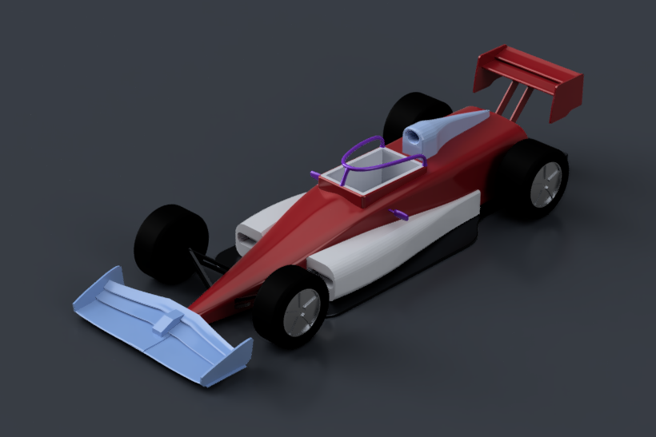
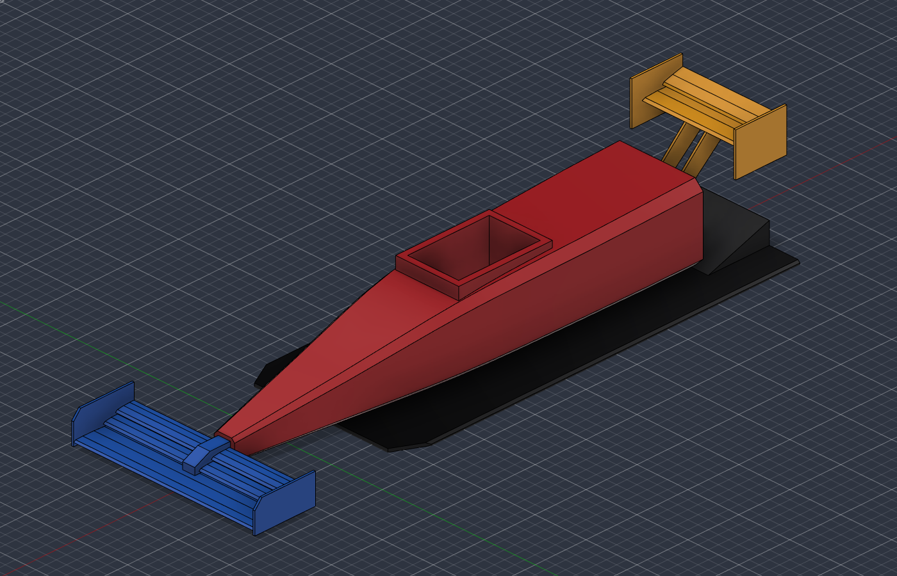
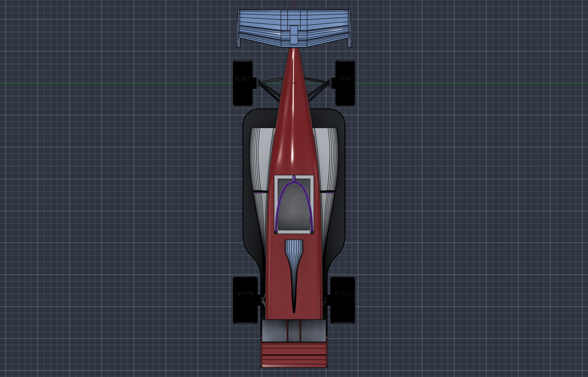

# AI F1 Engineering Agent

An experimental, concept-level pipeline. Claude plans a car part by part and writes the CAD script for each part.
Python checks every plan and script. Autodesk Fusion builds and measures the geometry through its MCP server. Every
part is kept in a versioned parts registry (`data/`), and a local web UI drives the runs.



> **Disclaimer.** This is an independent learning project. It is not affiliated with or endorsed by the FIA,
> Formula 1, Autodesk or Anthropic. All geometry is concept-level. See [Disclaimer](#disclaimer).

## What this is

- **An experimental pipeline**, not a product: brief → plan → one AI-written script per part → Fusion build →
  measurements → checks in Python → parts registry → assembly checks → screenshots and a summary.
- **Claude plans and writes scripts; it never runs Fusion and never judges a result.** Every PASS or FAIL is computed
  by Python from what Fusion measured.
- **A versioned parts registry.** Each part is a JSON record with its spec, script, pose, measurements and history;
  any part or the whole assembly can be rebuilt from the registry without calling Claude.
- **A local web UI** (`python -m ui`) and a CLI (`python -m agent`).
- **Two paths.** *Fast mode* (default page) builds a multi-part concept from one brief. The *strict* path
  (Advanced page) is an earlier, slower workflow with deterministic generators, user questions and provenance gates,
  shown on a machined L-bracket.

## What it is not

- **Not an FIA compliance check.** The only rule measured on a part is a width proxy for FIA article C2.3.1
  (|Y| ≤ 950 mm per part); the rule applies to the whole car, with exceptions. Everything else stays `NOT_VERIFIED`.
- **Not a structural analysis.** No FEA, no load cases in fast mode, no fatigue. A part that passes its checks is
  not shown to be strong, safe or manufacturable.
- **Not race-ready, and not a real car.** The geometry is a concept, roughly the shape of a single-seater.

## The Mini F1 demo

The example in `data/mini_f1/` was built from the UI between 2026-10-10 and 2026-10-12, with real Claude reasoning and
a live Fusion. The runs are recorded in `data/mini_f1/design_runs/`.

1. **Four parts from one brief** (`20261010-145347`): monocoque, front wing, floor and rear wing. 5 Claude calls
   (1 plan, 4 parts), 8 Fusion script calls. The planned floor / monocoque contact measured as a 28 mm gap and was
   reported `NON_COMPLIANT`: the monocoque script added its Z offset a second time. The pose was corrected
   (MON-001 v2) and checked in an assembly rebuild; the rebuild runs are not included.

   

2. **Extended to 18 parts** (`20261010-222202`): wheels, front and rear suspension, sidepods, engine cover, halo
   and mirrors. The four registered parts were reused unchanged. Only the left-hand parts were designed; the 6
   right-hand parts were **derived** from them by mirroring (wheels: turned 180° about Z), with no Claude call.
   10 Claude calls. The run used 37 Fusion script calls: it hit the 35-call budget, stopped, and was resumed.
3. **Palette and render** (`20261011-201406`): the assembly was rebuilt from the registry (0 Claude calls), coloured
   from `data/mini_f1/palette.json` and rendered locally in Fusion. The screenshots of this run use a different
   Fusion viewport style (white shaded with edges) from the other runs.
4. **Revisions** (`20261012-080916`): three parts were revised in words (floor, left mirror, monocoque), 1 Claude
   call and 4 script calls each; the right mirror was then re-derived from the revised left one (no Claude call). Revert
   (rebuild an older version as a new version) is implemented and tested, but no revert is recorded in these runs.

   

| Run | Parts | Claude calls | Fusion script calls | Cost reported by Claude Code |
|---|---|---|---|---|
| 20261010-145347 (first run) | 4 | 5 | 8 | $0.36 |
| 20261010-222202 (extension) | 18 | 10 | 37 | $1.13 |
| 20261011-201406 (rebuild, palette, render) | 18 | 0 | 72 | – |
| 20261012-080916 (rebuild, 3 revisions, render) | 18 | 3 (one per revision; the rebuild itself 0) | 33 | $0.79 |

## How it fits together

```
  browser ──► ui/server.py (127.0.0.1 only) ──► agent/design_service.py ──► agent/design_run.py (Orchestrator)
                                                                              │ run.json after every step
     ┌──────────────────────────────┬────────────────────────────────────────┼─────────────────────────┐
     ▼                              ▼                                        ▼                         ▼
 PLAN / PART / REPAIR          SCRIPT CHECK + PRELUDE                    FUSION                     CHECKS
 agent/fast_reasoning.py       fusion/script_safety.py (AST rules)       fusion/client.py           validation/part_checks.py
  claude -p, tools off,        fusion/prelude.py (document, anchor,       MCP JSON-RPC to           PART-* per part, mates,
  JSON schema per call          component, pose, colour, measurement)      127.0.0.1:27182/mcp       FIA width proxy
 agent/fast_prompts.py                                                    fusion/assembly.py
  schemas + plan gate                                                      (distance, interference)
                                                                              │
                                                     vehicle/store.py ◄───────┘  registry: data/<project>/components/
```

More detail: [docs/architecture.md](docs/architecture.md). All documents: [docs/README.md](docs/README.md).

## Try it without Fusion or Claude

You can install the package, run the tests and browse the recorded runs without Fusion, Claude or an internet
connection (after `pip install`). Tested on Windows 11 with Python 3.11 and 3.13 (the package requires 3.11+).

```bash
git clone <this repository> race_car_agent_public
cd race_car_agent_public
python -m venv .venv
.venv\Scripts\activate            # Windows (PowerShell or cmd)
# source .venv/bin/activate       # macOS / Linux
python -m pip install -e ".[dev]"
python -m pytest                   # about 540 tests, 3-5 minutes; live Fusion/Claude tests are skipped
python -m ui --read-only           # opens http://127.0.0.1:8765/ and shows the latest recorded run
```

If PowerShell refuses to run `activate` ("running scripts is disabled on this system"), run
`Set-ExecutionPolicy -Scope Process -ExecutionPolicy RemoteSigned` in that window first, or skip activation and call
`.venv\Scripts\python -m ...` directly.

In read-only mode the server refuses every action, so nothing can be started, no Claude or Fusion call is made and
nothing is written. Pick another run in the **Run** list. The Fusion pill shows "offline"; that is expected. The
Advanced page (`/advanced`) shows the strict-path bracket runs. Stop the server with Ctrl+C.

From the command line:

```bash
python -m agent parts              # the Mini F1 parts registry: versions, checks, bounding boxes
python -m agent design-status      # every recorded design run with its call counts
```

## Full setup (to design new parts)

You need:

- **Python 3.11+.** Tested on Windows 11 with Python 3.11 and 3.13.
- **Autodesk Fusion with its MCP server enabled**, under any licence that allows it. The agent connects to
  `http://127.0.0.1:27182/mcp`. Check the connection with `python -m agent fusion-check`. Keep the Fusion window
  visible: screenshots are taken from its viewport.
- **Claude Code, installed and logged in** (`claude` on the PATH). The agent calls `claude -p`; no API key is used.
  Set `AGENT_MODEL` to choose a model; otherwise Claude Code's default is used.

Then:

```bash
python -m pip install -e ".[dev]"
python -m ui                       # http://127.0.0.1:8765/
```

## Running a design

1. Start `python -m ui` with Fusion open.
2. Write a brief in the **Design brief** box and press **Run**. The four core parts (MON-001, FWG-001, FLR-001,
   RWG-001) are always planned; name an optional part id in the brief (for example WHL-FL) to add it. The catalogue
   is `MINI_F1_OPTIONAL` in `agent/fast_prompts.py`.
3. The run plans (it may ask you one question), builds each part in a new Fusion document, measures the assembly
   and takes screenshots. Nothing is saved or closed in Fusion; your other documents are not touched.
4. When it is done, click a part to revise it in words or revert it, rebuild the assembly from the registry, apply
   the palette or render.

The same from the CLI: `python -m agent design "<brief>"`, then `design-status`, `revise`, `rebuild-assembly`,
`recolor` and `render` (`python -m agent --help`). Automated live tests: `python -m pytest -m fusion` and
`python -m pytest -m claude`.

## The FIA regulation (optional)

The FIA regulation is not included. Without it everything works, and every FIA status stays `NOT_VERIFIED`. To
install your own copy (hash-checked), see [fia_rules/source/README.md](fia_rules/source/README.md).

## Safety notes

- **The script validator is not a sandbox.** `fusion/script_safety.py` rejects common model mistakes (other imports,
  file and process access, saving or closing documents, reaching outside the part). It does not make untrusted code
  safe. A registry record contains Python that Fusion runs: **only rebuild registries you trust.**
- **What is sent to Anthropic.** Each `claude -p` call sends a system prompt (the script contract in
  `docs/fusion_script_contract.md` and the rules) and a JSON input: the brief, the part catalogue, the registry
  summary, up to 6 FIA excerpts per part (only when the regulation is installed), the part spec, error messages for
  repairs and, for a revision, the part's script, measurements and your instruction. Images are sent only with
  visual review switched on (the iso screenshot) and, in the strict path, the images you attach. Claude Code runs
  with its tools disabled. Every request and response is stored in the run's `reasoning/` folder.
- **Local UI only.** The server binds to 127.0.0.1 and has no authentication. It accepts only Host
  `127.0.0.1:<port>` or `localhost:<port>`, refuses requests from other origins, and requires JSON for every POST.
  Do not expose it to a network.

## Known limits and open items

- One project kind for fast mode (the Mini F1 catalogue); rule data and FIA extraction are partial; the rule
  transcriptions have not been reviewed by a person.
- Fusion's MCP add-in leaks one stdout wrapper per script call; after a few hundred calls output is lost until
  Fusion restarts. Runs have a script-call budget for this reason.
- No API reasoning backend yet (only Claude Code and a file exchange); no FIA reference-volume or vehicle-layout
  checks; no FEA.
- The strict path has one generator (an L-bracket).
- One historical record (`data/prototype_bench/components/BRK-002.json`) carries legacy requirement labels; see
  `docs/architecture.md` §12.
- No automated JavaScript tests; the pages are checked by rendering them in a headless browser.

See [docs/development_plan.md](docs/development_plan.md) for the full list.

## How old records look

Records in `data/` are evidence and are not rewritten. They keep the words of their day:

- Stored statuses are the internal values, for example `C2.3.1 VERIFIED` and `MATE-… VERIFIED` in `run.json`,
  `summary.md` and the registry. The UI now shows the same results as "C2.3.1 width proxy MEASURED",
  `PASS (Fusion read-back matches the plan)` and `CONTACT_MEASURED`; the meaning is unchanged.
- Records cite files that are not included: the FIA regulation text (`fia_2026_section_c_iss20.txt`), `root.txt`
  (the original brief, published as `docs/dev-log/original_brief.md`) and the run folders below.
- The registry and revision snapshots contain 275 `run_id` references to 9 runs that are not included (intermediate
  assembly rebuilds). The parts and the four runs above are complete without them.
- The strict-path f1_parts example run (`data/f1_parts/`) has no screenshot: the captured frame was empty and was
  removed. Its `report.md` still links `screenshot.png`.

## How this was built

The code, tests and documents were written with Claude (Claude Code, Claude Opus), directed and reviewed by the
author. The AI-assisted development log is in [docs/dev-log/](docs/dev-log/): what was tried, what was measured,
what went wrong and how it was corrected. The original brief is `docs/dev-log/original_brief.md`. If you want to
learn from the code, start with [docs/LEARNING_GUIDE.md](docs/LEARNING_GUIDE.md).

## Disclaimer

This is an independent learning project. It is not affiliated with or endorsed by the FIA, Formula 1, Autodesk or
Anthropic. All geometry is concept-level: no FIA compliance, structural adequacy or race readiness is claimed. This
repository contains no reference images of real cars. The FIA regulations document is not included (see
`fia_rules/source/README.md`). FIA, Formula 1, F1, Autodesk, Fusion, Anthropic and Claude are trademarks of their
respective owners.

## Licence

MIT, for the code only (see [LICENSE](LICENSE)). It does not cover the FIA regulations or any third-party material.

---

Made by Muhammed Hakan Karas.
