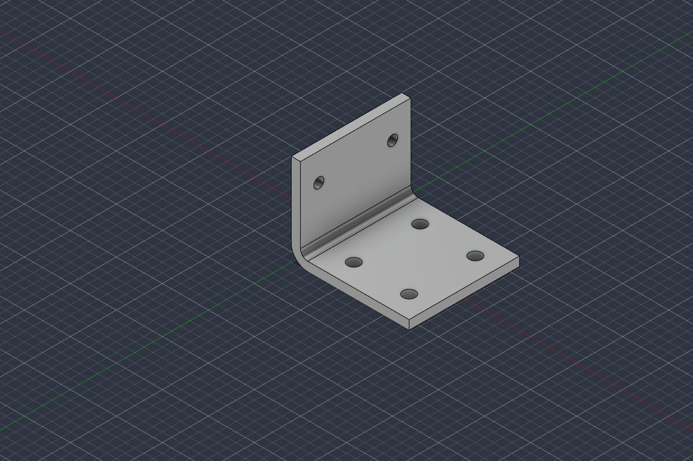

# Engineering report — run `20261005-203018-design-a-machined-alumin`

**Request:** Design a machined aluminium L-bracket to mount a 2 kg sensor box to a flat plate with four M6 bolts.

**Outcome:** Component **BRK-001 rev 1** registered as `CHECKED` (all blocking checks passed; concept-level design, see limitations).

**Check summary:** ASSUMPTION: 6, VERIFIED: 8, NOT_APPLICABLE: 1

## 1. Requirements

Machined aluminium L-bracket: base leg bolted to a flat plate with four M6 bolts; upright leg carries a 2 kg sensor box fixed with two M5 bolts 40 mm apart (user answer M01), box centre of mass 40 mm from its mounting face.

| ID | Key | Requirement | Value | Unit | Source |
|---|---|---|---|---|---|
| R01 | function | Mount a sensor box to a flat plate: base leg on the plate, sensor box on the upright leg. |  |  | USER |
| R02 | load | Supported payload: sensor box mass 2 kg. | 2 | kg | USER |
| R03 | base_fastener | Bracket fixed to the plate with four M6 bolts. | 4 x M6 |  | USER |
| R04 | manufacturing_process | Machined part. | machined |  | USER |
| R05 | material | Aluminium (alloy and temper not specified). | aluminium |  | USER |
| R06 | cad | Parametric, editable Fusion model with named parameters and features. |  |  | DERIVED |
| R07 | upright_fastener | Sensor box fixed to the upright with two M5 bolts side by side, 40 mm apart horizontally (one row). | 2 x M5 @ 40 mm |  | USER_ANSWER |
| R08 | payload_cg_offset | Sensor box centre of mass is 40 mm from its mounting face. | 40 | mm | USER_ANSWER |

## 2. Missing information and how it was resolved

| ID | Topic | Criticality | Resolution |
|---|---|---|---|
| M01 | Sensor-box mounting interface | CRITICAL | Asked: "How is the sensor box fastened to the bracket upright: fastener size, number of fasteners and hole pattern (e.g. 4 x M5 on a 36 mm (width) x 28 mm (height) rectangle), and roughly how far is the box's centre of mass from its mounting face?" → answer: Two M5 bolts side by side, 40 mm apart horizontally (one row). Sensor box centre of mass is 40 mm from its mounting face. |
| M02 | Aluminium alloy/temper | IMPORTANT | Assumed (A02) |
| M03 | Dynamic load factor / environment | IMPORTANT | Assumed (A03) |
| M04 | Available space | IMPORTANT | Assumed (A04) |
| M05 | Hole pattern in the flat plate | IMPORTANT | Assumed (A05) |

## 3. Engineering assumptions

| ID | Assumption | Rationale | Impact |
|---|---|---|---|
| A01 | Concept-level design: nominal geometry, no tolerancing, no FEA/fatigue analysis; sizing by hand calculation only. | Prototype 1 scope (root.txt §19). | Results are not a structural sign-off. |
| A02 | Material is aluminium 6061-T6 (material id AL6061-T6). | Most common general-purpose machining alloy; user said 'aluminium' only. | Yield strength 276 MPa (handbook, not verified) used in the bending check. |
| A03 | Design load = 2 kg x 5 g = 98.1 N applied at the box centre of mass, 40 mm from the upright face (R08), i.e. bending moment 3924 N*mm on the upright; required safety factor on yield 2.0. | No environment given; 5 g covers handling, shock and vibration typical of vehicle-mounted equipment at concept level. | Drives plate thickness; must be confirmed for the real environment. |
| A04 | No hard envelope limit; keep the bracket compact (each leg < 100 mm, width <= 70 mm). | Envelope not stated. | Leg lengths/width chosen from hole layout and edge-distance rules only. |
| A05 | The flat plate will be drilled to match the bracket; base holes in a 2 x 2 rectangular pattern with ISO 273 medium clearance (6.6 mm). | No plate pattern given. | Base hole pattern is defined by the bracket and must be transferred to the plate. |
| A06 | The sensor box can be mounted with its M5 hole row 35 mm above the plate (box bottom clears the base leg and bend). | Box dimensions unknown; 35 mm keeps the box above the 9 mm bend zone. | If the box hole row must be lower, upright_hole_z0 can be reduced to >= 11.75 mm. |
| A07 | M6 hex-head bolts with washers, installed from above with a socket: >= 15 mm clearance from hole centre to the upright inner face. | Tool access for the base bolts next to the upright. | Sets base_hole_x0. |

## 4. Engineering plan

1. Fix the interfaces first: base leg = 2x2 M6 pattern for the plate (R03, A05); upright = 1x2 M5 pattern 40 mm apart (R07/M01).
2. Size clearance holes from ISO 273 medium series (STD-ISO273-MEDIUM): M6 -> 6.6 mm, M5 -> 5.5 mm.
3. Set width and hole positions so every hole centre is >= 1.5 d from free edges (GL-HOLE-EDGE-DISTANCE) and clear of the bend fillet.
4. Choose plate thickness from the bending hand calculation (A03 load, A02 material) with margin for bolt clamping; respect min wall 2 mm (DFM-MACH-WALL-MIN).
5. Internal bend radius >= 3 mm for end-mill access (DFM-MACH-INNER-RADIUS-MIN) and >= 0.2 t (DFM-DFMEA-FATIGUE-FILLET).
6. Build the parametric model in Fusion (named user parameters, constrained sketches, named features).
7. Inspect read-only in Fusion; verify body count, feature health, bounding box, volume, parameters and every interface hole.
8. Review results; revise parameters if any blocking check fails.

**Manufacturing:** machined, material `AL6061-T6`  
**Design inputs:** base_fastener=M6, upright_fastener=M5, base_mates_with=flat_plate (external), upright_mates_with=sensor_box (external)  
**Load case:** 2 kg sensor box x 5 g, applied at its centre of mass 40 mm from the upright face: constant bending moment on the upright. — F = 98.1 N, lever arm 40 mm, required SF 2 (trace R02, R08, A03)

### Parameters (traceability)

| Parameter | Value | Unit | Source | Trace | Rationale |
|---|---|---|---|---|---|
| bracket_thickness | 5 | mm | ASSUMPTION | A01, A03, DFM-MACH-WALL-MIN | Hand calc at 4 mm already gives SF ~9 on yield; 5 mm chosen for bolt-clamping stiffness and thread-free clearance holes; > 2 mm min wall. |
| bend_inner_radius | 4 | mm | RULE | DFM-MACH-INNER-RADIUS-MIN, DFM-DFMEA-FATIGUE-FILLET | >= 3 mm end-mill radius rule and >= 0.2 t = 1 mm fatigue rule; 4 mm leaves margin for an 8 mm cutter. |
| bracket_width | 60 | mm | DERIVED | R07, GL-HOLE-EDGE-DISTANCE, A04 | M5 pitch 40 mm + 2 x 1.5 x 5.5 mm edge distance = 56.5 mm min -> 60 mm. |
| leg_base_length | 64 | mm | DERIVED | GL-HOLE-EDGE-DISTANCE, A04 | Last base hole row at 52 mm + 1.5 x 6.6 = 61.9 mm min -> 64 mm. |
| leg_upright_height | 50 | mm | DERIVED | GL-HOLE-EDGE-DISTANCE, A06, A04 | Hole row at 35 mm + 1.5 x 5.5 mm = 43.3 mm min; 50 mm gives a flat mounting face around the holes. |
| base_hole_diameter | 6.6 | mm | RULE | STD-ISO273-MEDIUM, R03 | ISO 273 medium clearance for M6. |
| base_hole_x0 | 22 | mm | ASSUMPTION | A07 | 17 mm from the upright inner face for M6 hex head / socket access (A07); clear of the 9 mm bend zone. |
| base_hole_pitch_x | 30 | mm | ASSUMPTION | A05 | Spread the 4 bolts along the leg to resist the overturning moment. |
| base_hole_pitch_y | 36 | mm | DERIVED | GL-HOLE-EDGE-DISTANCE, A05 | Side edge distance (60/2 - 18) = 12 mm = 1.82 d >= 1.5 d. |
| base_hole_rows | 2 | count | REQUIREMENT | R03, A05 | Four M6 bolts as a 2 x 2 pattern. |
| base_hole_cols | 2 | count | REQUIREMENT | R03, A05 | Four M6 bolts as a 2 x 2 pattern. |
| upright_hole_diameter | 5.5 | mm | RULE | STD-ISO273-MEDIUM, R07 | ISO 273 medium clearance for M5. |
| upright_hole_z0 | 35 | mm | ASSUMPTION | A06 | Hole row 35 mm above the plate keeps the sensor box clear of the base leg and bend (A06). |
| upright_hole_pitch_z | 0 | mm | DERIVED |  | Single row (R07) - pitch not used. |
| upright_hole_pitch_y | 40 | mm | USER | M01, R07 | Sensor box M5 holes 40 mm apart (user answer). |
| upright_hole_rows | 1 | count | USER | M01, R07 | Two bolts side by side = one row. |
| upright_hole_cols | 2 | count | USER | M01, R07 | Two bolts side by side. |

## 5. CAD (Autodesk Fusion via MCP)

- Fusion component: `BRK-001 Sensor box bracket` in document `Untitled` (Fusion 2705.1.11), body `BRK-001_body`, material `Aluminum 6061`
- Build script: `scripts/01_build.py` (re-runnable; regenerates the model from the record)

### Fusion measurements (read-only inspection)

- Body `BRK-001_body`: solid=True, volume 30941.231 mm³, area 14626.1 mm², bbox min [0.0, -30.0, 0.0] max [64.0, 30.0, 50.0] mm, material Aluminum 6061
- Features: SK_L_profile (HEALTHY), EX_L_profile (HEALTHY), FL_bend_inner (HEALTHY), FL_bend_outer (HEALTHY), SK_base_holes (HEALTHY), CUT_base_holes (HEALTHY), SK_upright_holes (HEALTHY), CUT_upright_holes (HEALTHY)
- Sketches: SK_L_profile (fully constrained: True), SK_base_holes (fully constrained: True), SK_upright_holes (fully constrained: True)
- User parameters in Fusion: 14 (editable; all dimensions are driven by them)

## 6. Validation results

### Passed under assumptions (assumed inputs or rule transcription not yet human-verified)

| Check | Category | Severity | Method | Measured | Limit | Rule | Note |
|---|---|---|---|---|---|---|---|
| DFM-MACH-WALL-MIN | MANUFACTURING | BLOCKING | PARAMETER_CHECK | 5 | >= 2.0 | DFM-MACH-WALL-MIN | Passes; rule transcription not yet human-verified. |
| DFM-MACH-INNER-RADIUS-MIN | MANUFACTURING | BLOCKING | PARAMETER_CHECK | 4 | >= 3.0 | DFM-MACH-INNER-RADIUS-MIN | Passes; rule transcription not yet human-verified. |
| DFM-DFMEA-FATIGUE-FILLET | MANUFACTURING | ADVISORY | PARAMETER_CHECK | 0.8 | >= 0.2 | DFM-DFMEA-FATIGUE-FILLET | Passes; rule transcription not yet human-verified. |
| STD-ISO273-MEDIUM | MANUFACTURING | ADVISORY | PARAMETER_CHECK | item=M6, value=6.6; item=M5, value=5.5 | M3=3.4, M4=4.5, M5=5.5, M6=6.6, M8=9, M10=11, M12=13.5 | STD-ISO273-MEDIUM | All items match the table. |
| GL-HOLE-EDGE-DISTANCE | MANUFACTURING | BLOCKING | PARAMETER_CHECK | 1.8182 | >= 1.5 | GL-HOLE-EDGE-DISTANCE | Passes; rule transcription not yet human-verified. |
| STR-PLATE-BENDING | STRUCTURAL | BLOCKING | HAND_CALC | moment_Nmm=3924, stress_MPa=19.22, safety_factor=14.36 | SF >= 2.0 |  | Upright leg as a plate under constant moment M = F*e (payload weight F at CG offset e from the upright face); critical net section through the upright hole row (W - 2 x hole). Material AL6061-T6 yield 276.0 MPa (NOT_VERIFIED). Stress concentration at holes/fillet and fatigue NOT included. |

### Verified (deterministic check passed; measured in Fusion or computed, rule human-verified or no rule needed)

| Check | Category | Severity | Method | Measured | Limit | Rule | Note |
|---|---|---|---|---|---|---|---|
| PROC-CAD-BUILD | PROCESS | BLOCKING | FUSION_MEASUREMENT |  |  |  |  |
| GEO-BODY-COUNT | GEOMETRY | BLOCKING | FUSION_MEASUREMENT | 1 | 1 |  |  |
| GEO-FEATURE-HEALTH | GEOMETRY | BLOCKING | FUSION_MEASUREMENT | 8/8 healthy |  |  |  |
| GEO-SKETCH-CONSTRAINED | GEOMETRY | ADVISORY | FUSION_MEASUREMENT | 3/3 |  |  |  |
| GEO-BBOX | GEOMETRY | BLOCKING | FUSION_MEASUREMENT | min=0; -30; 0, max=64; 30; 50 | min=0; -30; 0, max=64; 30; 50, tol_mm=0.001 |  | max deviation 0.00e+00 mm |
| GEO-VOLUME | GEOMETRY | BLOCKING | FUSION_MEASUREMENT | 30941.2 | 30941.231 ± 1e-04 rel |  | relative deviation 1.18e-15 |
| GEO-PARAM-SYNC | GEOMETRY | BLOCKING | FUSION_MEASUREMENT | 14/14 |  |  |  |
| IFC-HOLE-PATTERN | INTERFACE | BLOCKING | FUSION_MEASUREMENT | 6/6 holes matched | position/diameter tol 0.001 mm |  | All mounting holes verified in Fusion geometry. |

### Not applicable

| Check | Category | Severity | Method | Measured | Limit | Rule | Note |
|---|---|---|---|---|---|---|---|
| FIA-APPLICABILITY | FIA | ADVISORY | NOT_RUN | 6 structured FIA rules loaded; 0 apply to 'l_bracket' |  |  | No structured FIA rule applies to this component type; no FIA claim is made. |

### Rules used

| Rule | Authority | Source | Transcription status |
|---|---|---|---|
| DFM-DFMEA-FATIGUE-FILLET | PROJECT_RULE | CAD_Design_Rules.md §5 DFMEA | NOT_VERIFIED |
| DFM-MACH-INNER-RADIUS-MIN | PROJECT_RULE | CAD_Design_Rules.md §2.A Genel İşlenmiş Metal | NOT_VERIFIED |
| DFM-MACH-WALL-MIN | PROJECT_RULE | CAD_Design_Rules.md §2.A Genel İşlenmiş Metal | NOT_VERIFIED |
| GL-HOLE-EDGE-DISTANCE | GUIDELINE | Project guideline (no cited standard) | NOT_VERIFIED |
| STD-ISO273-MEDIUM | STANDARD | ISO 273 Fasteners - Clearance holes for bolts and screws (medium series) Table 1 | NOT_VERIFIED |

## 7. Regulatory (FIA) status

- NOT_APPLICABLE: No structured FIA rule applies to this component type; no FIA claim is made. (6 structured FIA rules loaded; 0 apply to 'l_bracket')
- No statement of FIA compliance is made by this report.

## 9. What remains unverified / limitations

- Concept-level design. Not structurally validated beyond the stated hand calculation (no FEA, no fatigue, no stress concentration, no bolt/joint analysis).
- Material properties are typical handbook values (NOT_VERIFIED against a supplier datasheet).
- Manufacturing checks are parameter-level rules only (no tool-path or fixture analysis).
- Rule transcriptions marked NOT_VERIFIED must be reviewed by a human (`python -m agent rules-verify <id> --by <name>`).
- Results depend on assumptions A01, A02, A03, A04, A05, A06, A07.
- Not FIA homologated, not race-ready, not production-ready, not human-verified.

## 10. Reviewer decisions

- **ACCEPT** — No blocking failures. Fusion measurements confirm the design intent: 1 solid body, 8/8 healthy features, 3/3 fully constrained sketches, bbox 64 x 60 x 50 mm, volume equal to the analytic model, 14/14 parameters in sync, and all 6 interface holes at designed position/axis/diameter. Rule checks pass but are ASSUMPTION status because the rule transcriptions (CAD_Design_Rules.md, ISO 273 table, edge-distance guideline) are not yet human-verified, and the bending check rests on assumed load (A03) and handbook material data (A02). Bending SF 14.4 vs required 2.0 means the bracket is conservative; thickness could be reduced if mass matters, but no mass target was given, and 5 mm is kept for bolt-clamping stiffness. Screenshot reviewed: geometry matches the plan.
