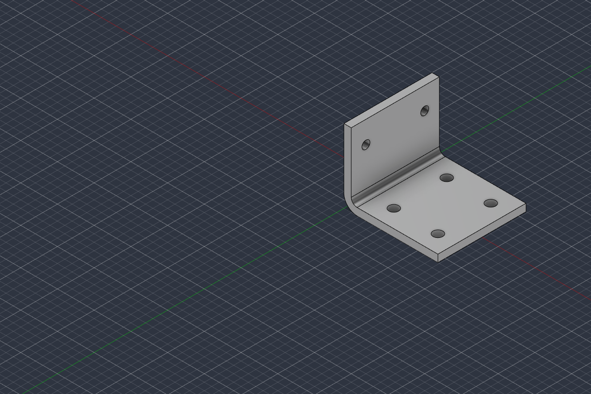

# Engineering report — run `20261005-205141-design-a-machined-alumin`

**Request:** Design a machined aluminium L-bracket to mount a 2 kg sensor box to a flat plate with four M6 bolts.

**Outcome:** Component **BRK-002 rev 1** registered as `CHECKED` (all blocking checks passed; concept-level design, see limitations).

**Check summary:** NOT_VERIFIED: 3, ASSUMPTION: 6, VERIFIED: 8, NOT_APPLICABLE: 1

**Evidence labels:** `CAD_BUILD_VERIFIED`, `FIA_NOT_APPLICABLE`, `GEOMETRY_VERIFIED` x5, `HOLE_GEOMETRY_VERIFIED`, `MANUFACTURING_RULE_ASSUMPTION` x5, `MATING_INTERFACE_NOT_VERIFIED` x2, `PARAMETERS_VERIFIED`, `STRUCTURAL_ADEQUACY_NOT_VERIFIED`, `STRUCTURAL_CHECK_ASSUMPTION`

## 1. Requirements

Machined aluminium L-bracket holding a 2 kg sensor box on a flat plate with four M6 bolts. The user answer M01 fixes the sensor-box fasteners (two M5 bolts, 40 mm apart horizontally) and its centre-of-mass offset (40 mm). The vertical position of the M5 holes on the carrying leg was asked for but not given; the follow-up answer M06 places them 35 mm above the flat plate.

Each requirement is the **AI's interpretation**; the authoritative source is the user's own words (request or verbatim answer) quoted next to it.

| ID | Key | Origin | User's words (verbatim) | AI interpretation | Value | Unit |
|---|---|---|---|---|---|---|
| R01 | function | USER_REQUEST | "L-bracket to mount a 2 kg sensor box to a flat plate" | AI interpretation: an L-shaped bracket that holds a sensor box on a flat plate; the base leg sits on the plate and the other leg carries the sensor box. |  |  |
| R02 | load | USER_REQUEST | "2 kg sensor box" | AI interpretation: the supported payload is the sensor box with a mass of 2 kg (static mass only; no load direction, dynamic factor or centre of mass stated). | 2 | kg |
| R03 | base_fastener | USER_REQUEST | "to a flat plate with four M6 bolts" | AI interpretation: the bracket is fastened to the flat plate with four M6 bolts. | 4 x M6 |  |
| R04 | manufacturing_process | USER_REQUEST | "machined" | AI interpretation: the bracket is a machined part. | machined |  |
| R05 | material | USER_REQUEST | "machined aluminium" | AI interpretation: the bracket material is aluminium; alloy and temper are not specified. | aluminium |  |
| R06 | upright_fastener | USER_ANSWER (M01) | "attached with two M5 bolts, 40 mm apart horizontally" | AI interpretation: the sensor box is fastened to the carrying leg with two M5 bolts, 40 mm apart horizontally, side by side at the same height; the bracket therefore needs two M5 clearance holes in that leg. | 2 x M5 @ 40 mm |  |
| R07 | payload_cg_offset | USER_ANSWER (M01) | "The centre of mass is 40 mm from the mounting face" | AI interpretation: the sensor box centre of mass lies 40 mm from its mounting face, i.e. 40 mm away from the face of the carrying leg; this is the lever arm of the box weight. | 40 | mm |
| R08 | upright_hole_position | USER_ANSWER (M06) | "The two M5 holes are 35 mm above the flat plate" | AI interpretation: the centres of the two M5 holes are 35 mm above the flat plate, i.e. 35 mm above the bottom face of the base leg (interpretation: the figure is taken as hole-centre height, not hole-edge height). | 35 | mm |

### Customer answers (verbatim, authoritative)

- **M01** Q: "How is the sensor box attached to the bracket leg that carries it (fastener type, size, number and hole positions), and where is the sensor box's centre of mass relative to its mounting face?"  
  A (user, 2026-10-05T17:54:14+00:00, via cli: python -m agent answer): "The sensor box is attached with two M5 bolts, 40 mm apart horizontally. The centre of mass is 40 mm from the mounting face"
- **M06** Q: "Your answer gives the horizontal spacing of the two M5 bolts. At what height above the flat plate should the two M5 holes be, or, if you do not have that figure, how far does the sensor box extend below its two M5 holes?"  
  A (user, 2026-10-05T17:57:24+00:00, via cli: python -m agent answer): "The two M5 holes are 35 mm above the flat plate."

## 2. Missing information and how it was resolved

| ID | Topic | Criticality | Resolution |
|---|---|---|---|
| M01 | Sensor-box attachment and centre of mass | CRITICAL | Asked: "How is the sensor box attached to the bracket leg that carries it (fastener type, size, number and hole positions), and where is the sensor box's centre of mass relative to its mounting face?" → user answer: "The sensor box is attached with two M5 bolts, 40 mm apart horizontally. The centre of mass is 40 mm from the mounting face" |
| M02 | Aluminium alloy and temper | IMPORTANT | Assumed (A02) |
| M03 | Dynamic load / environment | IMPORTANT | Assumed (A03) |
| M04 | Available space | IMPORTANT | Assumed (A04) |
| M05 | Hole pattern in the flat plate | IMPORTANT | Assumed (A05) |
| M06 | Vertical position of the sensor-box holes | CRITICAL | Asked: "Your answer gives the horizontal spacing of the two M5 bolts. At what height above the flat plate should the two M5 holes be, or, if you do not have that figure, how far does the sensor box extend below its two M5 holes?" → user answer: "The two M5 holes are 35 mm above the flat plate." (clarifies M01) |

## 3. Engineering assumptions

| ID | Assumption | Rationale | Impact |
|---|---|---|---|
| A01 | Concept-level design: nominal geometry, no tolerancing, no FEA or fatigue analysis; sizing by one hand calculation only. | MVP scope. | Results are not a structural sign-off. |
| A02 | ENGINEERING ASSUMPTION (not stated by the user): aluminium 6061-T6 (material id AL6061-T6). | Common general-purpose machining alloy; the request says only 'aluminium'. | Handbook yield strength (NOT_VERIFIED) used in the bending check. |
| A03 | ENGINEERING ASSUMPTION (not stated by the user): design load = 5 x the static weight of the 2 kg box, required safety factor on yield 2.0. | No environment given; covers handling, shock and vibration at concept level. | Drives plate thickness; must be confirmed for the real environment. |
| A04 | ENGINEERING ASSUMPTION (not stated by the user): no hard envelope limit; keep the bracket compact. | Envelope not stated. | Leg lengths and width follow from hole layout and edge-distance rules. |
| A05 | ENGINEERING ASSUMPTION (not stated by the user): the flat plate will be drilled to match the bracket's M6 hole pattern. | No plate pattern given. | The bracket defines the plate drilling pattern. |
| A06 | ENGINEERING ASSUMPTION (not stated by the user): M6 hex-head bolts with washers installed from above with a socket; >= 15 mm from hole centre to the inner face of the carrying leg. | Tool access for the base bolts next to the carrying leg. | Sets base_hole_x0. |

## 4. Engineering plan

1. Fix the interfaces from the user's words: base leg 4 x M6 to the plate (R03); carrying leg 2 x M5, 40 mm apart horizontally (R06), hole centres 35 mm above the plate (R08).
2. Size clearance holes per STD-ISO273-MEDIUM: M6 -> 6.6 mm, M5 -> 5.5 mm.
3. Choose width, leg lengths and base-hole layout so every hole centre is >= 1.5 d from free edges (GL-HOLE-EDGE-DISTANCE) and clear of the bend.
4. Choose thickness from the bending hand calculation with the user's lever arm (R07) and the assumed design load (A03, A02); respect min wall (DFM-MACH-WALL-MIN).
5. Internal bend radius per DFM-MACH-INNER-RADIUS-MIN and DFM-DFMEA-FATIGUE-FILLET.
6. Build the parametric model in Fusion; inspect read-only; validate; review.

**Manufacturing:** machined, material `AL6061-T6`  
**Design inputs:** base_fastener=M6, upright_fastener=M5, base_mates_with=flat_plate (external, not modelled), upright_mates_with=sensor_box (external, not modelled)  
**Load case:** Box weight 2 kg (R02) x assumed factor 5 (A03) = 98.1 N acting at the user's centre-of-mass offset of 40 mm (R07) from the carrying-leg face: constant bending moment on that leg. — F = 98.1 N, lever arm 40 mm, required SF 2 (trace R02, R07, A03)

### Parameters (traceability)

| Parameter | Value | Unit | Source | Trace | Rationale |
|---|---|---|---|---|---|
| bracket_thickness | 5 | mm | ASSUMPTION | A01, A03, DFM-MACH-WALL-MIN | Engineering decision: hand calc with the assumed load gives a large margin already at 4 mm; 5 mm chosen for bolt-clamping stiffness. |
| bend_inner_radius | 4 | mm | RULE | DFM-MACH-INNER-RADIUS-MIN, DFM-DFMEA-FATIGUE-FILLET | >= 3 mm end-mill rule and >= 0.2 t fatigue rule. |
| bracket_width | 60 | mm | DERIVED | R06, GL-HOLE-EDGE-DISTANCE, A04 | User M5 spacing 40 mm (R06) + 2 x 1.5 x 5.5 mm edge distance = 56.5 mm minimum -> 60 mm. |
| leg_base_length | 64 | mm | DERIVED | GL-HOLE-EDGE-DISTANCE, A04, A05 | Last base hole row at 52 mm + 1.5 x 6.6 mm = 61.9 mm minimum -> 64 mm. |
| leg_upright_height | 50 | mm | DERIVED | R08, GL-HOLE-EDGE-DISTANCE, A04 | User hole height 35 mm (R08) + 1.5 x 5.5 mm = 43.25 mm minimum -> 50 mm. |
| base_hole_diameter | 6.6 | mm | RULE | STD-ISO273-MEDIUM, R03 | ISO 273 medium clearance for the user's M6 bolts. |
| base_hole_x0 | 22 | mm | ASSUMPTION | A06 | Engineering decision: socket access next to the carrying leg (A06). |
| base_hole_pitch_x | 30 | mm | ASSUMPTION | A05 | Engineering decision: spread the four M6 bolts along the base to resist the overturning moment; plate drilled to suit (A05). |
| base_hole_pitch_y | 36 | mm | DERIVED | GL-HOLE-EDGE-DISTANCE, A05 | Side edge distance (30 - 18) = 12 mm = 1.82 d >= 1.5 d. |
| base_hole_rows | 2 | count | REQUIREMENT | R03, A05 | Four M6 bolts (R03) arranged 2 x 2 (A05). |
| base_hole_cols | 2 | count | REQUIREMENT | R03, A05 | Four M6 bolts (R03) arranged 2 x 2 (A05). |
| upright_hole_diameter | 5.5 | mm | RULE | STD-ISO273-MEDIUM, R06 | ISO 273 medium clearance for the user's M5 bolts. |
| upright_hole_z0 | 35 | mm | USER | M06, R08 | User: hole centres 35 mm above the flat plate (R08 interpretation of M06). |
| upright_hole_pitch_z | 0 | mm | DERIVED |  | Single row of holes (R06) - not used. |
| upright_hole_pitch_y | 40 | mm | USER | M01, R06 | User: M5 bolts 40 mm apart horizontally. |
| upright_hole_rows | 1 | count | USER | M01, R06 | Two bolts side by side horizontally (R06 interpretation). |
| upright_hole_cols | 2 | count | USER | M01, R06 | Two M5 bolts (user). |

## 5. CAD (Autodesk Fusion via MCP)

- Fusion component: `BRK-002 Sensor box bracket` in document `Untitled` (Fusion 2705.1.11), body `BRK-002_body`, material `Aluminum 6061`
- Build script: `scripts/01_build.py` (re-runnable; regenerates the model from the record)

### Fusion measurements (read-only inspection)

- Body `BRK-002_body`: solid=True, volume 30941.231 mm³, area 14626.1 mm², bbox min [0.0, -30.0, 0.0] max [64.0, 30.0, 50.0] mm, material Aluminum 6061
- Features: SK_L_profile (HEALTHY), EX_L_profile (HEALTHY), FL_bend_inner (HEALTHY), FL_bend_outer (HEALTHY), SK_base_holes (HEALTHY), CUT_base_holes (HEALTHY), SK_upright_holes (HEALTHY), CUT_upright_holes (HEALTHY)
- Sketches: SK_L_profile (fully constrained: True), SK_base_holes (fully constrained: True), SK_upright_holes (fully constrained: True)
- User parameters in Fusion: 14 (editable; all dimensions are driven by them)

## 6. Validation results

### Not verified (not checked / could not be checked)

| Evidence label | Check | Claim (exactly what this result establishes) | Severity | Method | Measured | Limit | Note |
|---|---|---|---|---|---|---|---|
| MATING_INTERFACE_NOT_VERIFIED | IFC-MATING@IF-BASE | Whether the mating part's holes/faces coincide with this interface. Not checked: the mating part is not modelled in the project. | ADVISORY | NOT_RUN |  |  | Mating part geometry not available; fit, hole alignment and clearance are not verified. |
| MATING_INTERFACE_NOT_VERIFIED | IFC-MATING@IF-UPRIGHT | Whether the mating part's holes/faces coincide with this interface. Not checked: the mating part is not modelled in the project. | ADVISORY | NOT_RUN |  |  | Mating part geometry not available; fit, hole alignment and clearance are not verified. |
| STRUCTURAL_ADEQUACY_NOT_VERIFIED | STR-ADEQUACY | Whether the part is structurally adequate in service. Not established: only one simplified hand calculation was run. | ADVISORY | NOT_RUN |  |  | Not analysed: bolt loads/prying, base-leg bending, fatigue, stress concentration, FEA. |

### Passed under assumptions (assumed inputs or rule transcription not yet human-verified)

| Evidence label | Check | Claim (exactly what this result establishes) | Severity | Method | Measured | Limit | Note |
|---|---|---|---|---|---|---|---|
| MANUFACTURING_RULE_ASSUMPTION | DFM-MACH-WALL-MIN | Design value of 'wall_thickness' satisfies rule DFM-MACH-WALL-MIN as transcribed (transcription NOT_VERIFIED). | BLOCKING | PARAMETER_CHECK | 5 | >= 2.0 | Passes; rule transcription not yet human-verified. |
| MANUFACTURING_RULE_ASSUMPTION | DFM-MACH-INNER-RADIUS-MIN | Design value of 'internal_corner_radius' satisfies rule DFM-MACH-INNER-RADIUS-MIN as transcribed (transcription NOT_VERIFIED). | BLOCKING | PARAMETER_CHECK | 4 | >= 3.0 | Passes; rule transcription not yet human-verified. |
| MANUFACTURING_RULE_ASSUMPTION | DFM-DFMEA-FATIGUE-FILLET | Design value of 'fillet_to_thickness_ratio' satisfies rule DFM-DFMEA-FATIGUE-FILLET as transcribed (transcription NOT_VERIFIED). | ADVISORY | PARAMETER_CHECK | 0.8 | >= 0.2 | Passes; rule transcription not yet human-verified. |
| MANUFACTURING_RULE_ASSUMPTION | STD-ISO273-MEDIUM | Design value of 'clearance_holes' satisfies rule STD-ISO273-MEDIUM as transcribed (transcription NOT_VERIFIED). | ADVISORY | PARAMETER_CHECK | item=M6, value=6.6; item=M5, value=5.5 | M3=3.4, M4=4.5, M5=5.5, M6=6.6, M8=9, M10=11, M12=13.5 | All items match the table. |
| MANUFACTURING_RULE_ASSUMPTION | GL-HOLE-EDGE-DISTANCE | Design value of 'hole_edge_distance_ratio' satisfies rule GL-HOLE-EDGE-DISTANCE as transcribed (transcription NOT_VERIFIED). | BLOCKING | PARAMETER_CHECK | 1.8182 | >= 1.5 | Passes; rule transcription not yet human-verified. |
| STRUCTURAL_CHECK_ASSUMPTION | STR-PLATE-BENDING | One simplified hand calculation (plate bending at the critical section vs yield) meets the required safety factor. Not a structural-adequacy statement. | BLOCKING | HAND_CALC | moment_Nmm=3924, stress_MPa=19.22, safety_factor=14.36 | SF >= 2.0 | Upright leg as a plate under constant moment M = F*e (payload weight F at CG offset e from the upright face); critical net section through the upright hole row (W - 2 x hole). Material AL6061-T6 yield 276.0 MPa (NOT_VERIFIED). Stress concentration at holes/fillet and fatigue NOT included. |

### Verified (deterministic check passed; measured in Fusion or computed, rule human-verified or no rule needed)

| Evidence label | Check | Claim (exactly what this result establishes) | Severity | Method | Measured | Limit | Note |
|---|---|---|---|---|---|---|---|
| CAD_BUILD_VERIFIED | PROC-CAD-BUILD | The generated Fusion script ran to completion without error. | BLOCKING | FUSION_MEASUREMENT |  |  |  |
| GEOMETRY_VERIFIED | GEO-BODY-COUNT | Fusion reports the designed number of bodies, all solid. | BLOCKING | FUSION_MEASUREMENT | 1 | 1 |  |
| GEOMETRY_VERIFIED | GEO-FEATURE-HEALTH | Every Fusion timeline feature of the component computed without warning or error. | BLOCKING | FUSION_MEASUREMENT | 8/8 healthy |  |  |
| GEOMETRY_VERIFIED | GEO-SKETCH-CONSTRAINED | Every sketch is fully constrained (geometry fully driven by dimensions/constraints). | ADVISORY | FUSION_MEASUREMENT | 3/3 |  |  |
| GEOMETRY_VERIFIED | GEO-BBOX | Fusion-measured overall extents equal the designed extents (overall size only). | BLOCKING | FUSION_MEASUREMENT | min=0; -30; 0, max=64; 30; 50 | min=0; -30; 0, max=64; 30; 50, tol_mm=0.001 | max deviation 0.00e+00 mm |
| GEOMETRY_VERIFIED | GEO-VOLUME | Fusion-measured volume equals the generator's analytic volume (consistency with design intent). | BLOCKING | FUSION_MEASUREMENT | 30941.2 | 30941.231 ± 1e-04 rel | relative deviation 1.18e-15 |
| PARAMETERS_VERIFIED | GEO-PARAM-SYNC | Fusion holds the parameter values of the record (does not by itself prove the geometry follows them). | BLOCKING | FUSION_MEASUREMENT | 14/14 |  |  |
| HOLE_GEOMETRY_VERIFIED | IFC-HOLE-GEOMETRY | This component's own mounting holes exist in Fusion with the designed diameter, axis and position. Says nothing about the mating part. | BLOCKING | FUSION_MEASUREMENT | 6/6 holes matched | position/diameter tol 0.001 mm | All own mounting holes found in Fusion geometry. |

### Not applicable

| Evidence label | Check | Claim (exactly what this result establishes) | Severity | Method | Measured | Limit | Note |
|---|---|---|---|---|---|---|---|
| FIA_NOT_APPLICABLE | FIA-APPLICABILITY | None of the structured FIA rules in the project targets this component type. No FIA compliance statement of any kind. | ADVISORY | NOT_RUN | 6 structured FIA rules loaded; 0 apply to 'l_bracket' |  | No structured FIA rule applies to this component type; no FIA claim is made. |

### Rules used

| Rule | Authority | Source | Transcription status |
|---|---|---|---|
| DFM-DFMEA-FATIGUE-FILLET | PROJECT_RULE | CAD_Design_Rules.md §5 DFMEA | NOT_VERIFIED |
| DFM-MACH-INNER-RADIUS-MIN | PROJECT_RULE | CAD_Design_Rules.md §2.A Genel İşlenmiş Metal | NOT_VERIFIED |
| DFM-MACH-WALL-MIN | PROJECT_RULE | CAD_Design_Rules.md §2.A Genel İşlenmiş Metal | NOT_VERIFIED |
| GL-HOLE-EDGE-DISTANCE | GUIDELINE | Project guideline (no cited standard) | NOT_VERIFIED |
| STD-ISO273-MEDIUM | STANDARD | ISO 273 Fasteners - Clearance holes for bolts and screws (medium series) Table 1 | NOT_VERIFIED |

## 7. Regulatory (FIA) status

- NOT_APPLICABLE: No structured FIA rule applies to this component type; no FIA claim is made. (6 structured FIA rules loaded; 0 apply to 'l_bracket')
- No statement of FIA compliance is made by this report.

## 9. What remains unverified / limitations

- Concept-level design. Not structurally validated beyond the stated hand calculation (no FEA, no fatigue, no stress concentration, no bolt/joint analysis).
- Material properties are typical handbook values (NOT_VERIFIED against a supplier datasheet).
- Manufacturing checks are parameter-level rules only (no tool-path or fixture analysis).
- Rule transcriptions marked NOT_VERIFIED must be reviewed by a human (`python -m agent rules-verify <id> --by <name>`).
- Results depend on assumptions A01, A02, A03, A04, A05, A06.
- Not FIA homologated, not race-ready, not production-ready, not human-verified.

## 10. Reviewer decisions

- **ACCEPT** — No blocking failures. Fusion measurements match the design: 1 solid body, 8/8 healthy features, 3/3 fully constrained sketches, bbox 64 x 60 x 50 mm, volume equal to the analytic model, 14/14 parameters, and the bracket's own 6 holes at designed position/axis/diameter - including the user-specified M5 pair 40 mm apart with centres 35 mm above the plate face (HOLE_GEOMETRY_VERIFIED). Accepted at concept level only: fit with the plate and sensor box is MATING_INTERFACE_NOT_VERIFIED (parts not modelled); the bending check is STRUCTURAL_CHECK_ASSUMPTION (assumed load factor A03, handbook material A02) and overall STRUCTURAL_ADEQUACY_NOT_VERIFIED; manufacturing rules pass as ASSUMPTION because their transcriptions are not human-verified. Screenshot reviewed. Note: the hole-height figure was interpreted as hole-centre height (R08).
