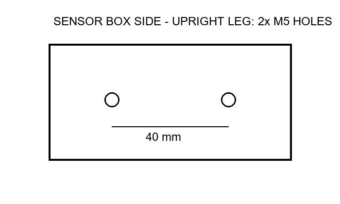
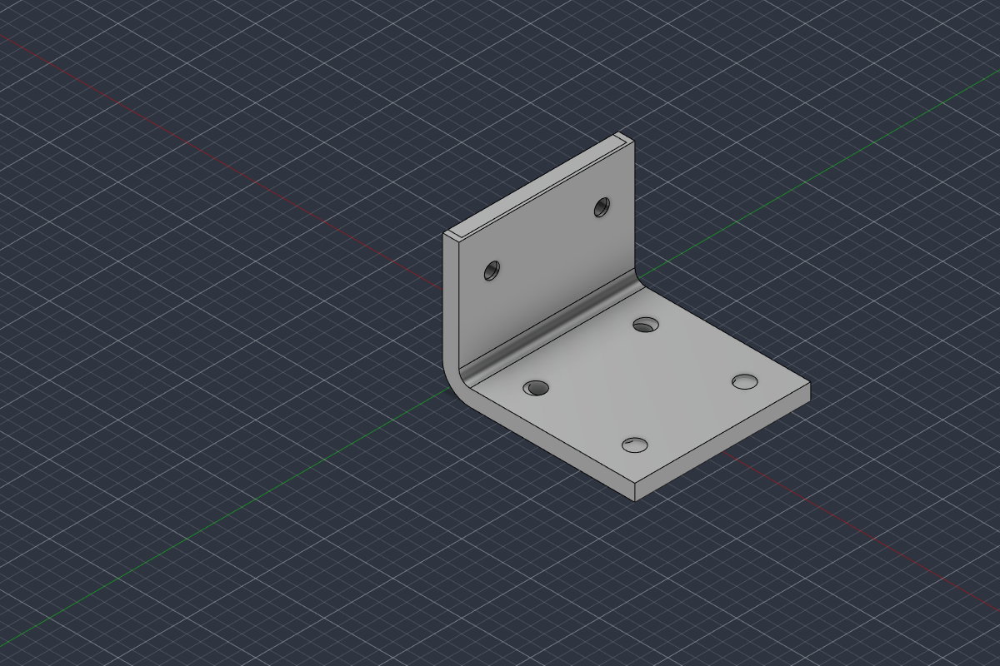

# Engineering report — run `20261005-220102-e2e-test-scripted-custom`

**Request:** E2E TEST (scripted customer answers): Design a machined aluminium L-bracket to mount a 2 kg sensor box to a flat plate with four M6 bolts. The sensor-box side is shown in the attached sketch.

**Source image IMG-01:** `attachments/IMG-01.png` ('sensor_side_sketch.png', image/png, 8883 bytes, sha256 `68ed28b096bc8578f7b6bd5cbdb1b5da9f38b2f3b64b0a1d4a84d874797914d7`) — user-supplied evidence; values read from it are marked IMAGE, not user words.  

**Outcome:** Component **BRK-001 rev 1** registered as `CHECKED` (all blocking checks passed; concept-level design, see limitations).

**Check summary:** NOT_VERIFIED: 3, ASSUMPTION: 6, VERIFIED: 8, NOT_APPLICABLE: 1

**Evidence labels:** `CAD_BUILD_VERIFIED`, `FIA_NOT_APPLICABLE`, `GEOMETRY_VERIFIED` x5, `HOLE_GEOMETRY_VERIFIED`, `MANUFACTURING_RULE_ASSUMPTION` x5, `MATING_INTERFACE_NOT_VERIFIED` x2, `PARAMETERS_VERIFIED`, `STRUCTURAL_ADEQUACY_NOT_VERIFIED`, `STRUCTURAL_CHECK_ASSUMPTION`

## 1. Requirements

Machined aluminium 6061-T6 L-bracket mounting a 2 kg sensor box to a horizontal flat plate. Base leg: four M6 bolts into the plate. The plate is undrilled, so the bracket sets the base hole pattern. Upright leg: two M5 bolts, 40 mm apart horizontally, hole centres 35 mm above the plate, confirmed by the IMG-01 sketch. Load: weight acts downward, centre of mass 40 mm from the mounting face, dynamic factor 3, safety factor 2 on yield. The bracket must fit inside 80 mm in every direction. All required_info keys are covered by user statements. The remaining gaps (centre-of-mass position along the other two axes, base bolt layout) are handled as explicit assumptions. This is a concept-level design: no FEA and no compliance claims.

Each requirement is the **AI's interpretation**; the authoritative source is the user's own words (request or verbatim answer) quoted next to it, or — for origin IMAGE — what the AI read in a user-supplied image (extracted evidence, not the user's words).

| ID | Key | Origin | Source evidence | AI interpretation | Value | Unit |
|---|---|---|---|---|---|---|
| R01 | function | USER_REQUEST | "mount a 2 kg sensor box to a flat plate" | The L-bracket mounts a 2 kg sensor box to a flat plate. |  |  |
| R02 | material | USER_ANSWER (M01) | "Material: aluminium 6061-T6." | Bracket material is aluminium 6061-T6. | aluminium 6061-T6 |  |
| R03 | manufacturing_process | USER_REQUEST | "Design a machined aluminium L-bracket" | The bracket is a machined aluminium L-bracket. | machined |  |
| R04 | base_fastener | USER_REQUEST | "to a flat plate with four M6 bolts" | The base leg is fastened to the flat plate with four M6 bolts. | M6 |  |
| R05 | upright_fastener | USER_ANSWER (M01) | "The sensor box is attached with two M5 bolts, 40 mm apart horizontally, hole centres 35 mm above the flat plate." | The sensor box is attached to the upright leg with two M5 bolts, 40 mm apart horizontally, hole centres 35 mm above the flat plate. |  |  |
| R06 | upright_fastener_image | IMAGE (IMG-01) | image IMG-01: "Title text 'SENSOR BOX SIDE - UPRIGHT LEG: 2x M5 HOLES'; two circles on a horizontal line with dimension '40 mm' between their centres." (AI reading) | The sketch shows the upright leg with 2x M5 holes, spaced 40 mm apart. This is consistent with the user's answer. |  |  |
| R07 | load | USER_REQUEST | "a 2 kg sensor box" | The supported mass is 2 kg (sensor box). | 2 | kg |
| R08 | load_direction | USER_ANSWER (M01) | "The plate is horizontal; the sensor box is mounted on the vertical leg and its weight acts downward." | The plate is horizontal. The sensor box is on the vertical (upright) leg and its weight acts downward. |  |  |
| R09 | load_com_offset | USER_ANSWER (M01) | "The centre of mass is 40 mm from the mounting face." | The sensor box centre of mass is 40 mm from the upright mounting face. | 40 | mm |
| R10 | load_factors | USER_ANSWER (M01) | "Use a dynamic factor of 3 and a safety factor of 2 on yield." | Design with a dynamic factor of 3 and a safety factor of 2 on yield. |  |  |
| R11 | envelope | USER_ANSWER (M02) | "The bracket must fit inside 80 mm in every direction." | The bracket must fit inside 80 mm in every direction. | 80 | mm |
| R12 | plate_interface | USER_ANSWER (M02) | "The plate is not drilled yet; drill it to suit the bracket." | The plate has no existing holes. The plate holes will be drilled to suit the bracket's base hole pattern. |  |  |

### Customer answers (verbatim, authoritative)

- **M01** Q: "What load case should the bracket be designed for? Please give the orientation of the flat plate and the direction of the sensor box weight relative to it, any dynamic, vibration or acceleration loads, the required safety factor, and where the sensor box centre of mass sits relative to the upright mounting face."  
  A (user, 2026-10-05T19:01:34+00:00, via ui: web interface): "[scripted E2E test answer] The sensor box is attached with two M5 bolts, 40 mm apart horizontally, hole centres 35 mm above the flat plate. The centre of mass is 40 mm from the mounting face. The plate is horizontal; the sensor box is mounted on the vertical leg and its weight acts downward. Use a dynamic factor of 3 and a safety factor of 2 on yield. The plate is not drilled yet; drill it to suit the bracket. The bracket must fit inside 80 mm in every direction. Material: aluminium 6061-T6."
- **M02** Q: "What space is available for the bracket on the plate and around the sensor box? Are there any maximum dimensions, keep-out zones or a defined bolt pattern on the plate?"  
  A (user, 2026-10-05T19:01:35+00:00, via ui: web interface): "[scripted E2E test answer] The sensor box is attached with two M5 bolts, 40 mm apart horizontally, hole centres 35 mm above the flat plate. The centre of mass is 40 mm from the mounting face. The plate is horizontal; the sensor box is mounted on the vertical leg and its weight acts downward. Use a dynamic factor of 3 and a safety factor of 2 on yield. The plate is not drilled yet; drill it to suit the bracket. The bracket must fit inside 80 mm in every direction. Material: aluminium 6061-T6."

## 2. Missing information and how it was resolved

| ID | Topic | Criticality | Resolution |
|---|---|---|---|
| M03 | Sensor box centre-of-mass position along the other two axes (horizontal across the upright, and height above the plate) | IMPORTANT | Assumed (A03) |
| M04 | Positions of the four M6 holes in the base leg | MINOR | Assumed (A02) |

## 3. Engineering assumptions

| ID | Assumption | Rationale | Impact |
|---|---|---|---|
| A01 | Scope: concept-level design with nominal geometry. Strength is checked with hand calculations only: no FEA, fatigue or tolerance analysis. No claim of structural safety, regulatory compliance or production readiness. | The project is a prototype bench with no regulation, and this generator supports concept-level checks only. | The results are indicative. Detailed verification is needed before use. |
| A02 | The four M6 base holes are placed symmetrically in a rectangular pattern within the 80 mm envelope. Hole positions and edge distances are chosen by the design and documented as parameters. | The user said the plate will be drilled to suit the bracket (R12) but gave no pattern. | The plate must be drilled to the pattern the bracket defines. |
| A03 | The sensor box centre of mass is assumed to sit centred horizontally between the two M5 holes and at the hole-centre height of 35 mm above the plate. Its stated 40 mm offset from the mounting face is used as given. | The user gave only the offset from the mounting face. A centred position is the neutral choice and adds no torsion. | If the centre of mass is offset sideways or higher up, root bending and bolt loads increase. The checks should be re-run if this is known. |
| A04 | Design load = mass x 9.81 m/s^2 x dynamic factor, acting downward. Allowable stress = 6061-T6 yield strength / safety factor. | This applies the user-given factors (R10) in the standard way. The 6061-T6 yield value comes from the material database, not from the user. | Sets the design force and allowable stress for the checks. |
| A05 | The bending lever arm for the upright-root hand calculation is measured from the centre-of-mass line to the mid-plane of the upright: 40 mm (R09) + bracket_thickness/2 (3 mm) = 43 mm. Hole-section reduction and bolt prying are not modelled. | The user gave the offset from the mounting face (outer face x = 0). The section mid-plane is the right reference for beam bending, and adding t/2 is slightly conservative. | The root moment is about 7.5% higher than with 40 mm. If the thickness changes, the lever arm must be updated. |

## 4. Engineering plan

1. Fix the interfaces: upright gets 1 row x 2 cols of M5 clearance holes at 40 mm pitch, 35 mm above the base bottom face (R05, R06). Base gets 2x2 M6 clearance holes in a symmetric rectangular pattern (R04, A02).
2. Size the envelope inside 80 mm (R11): base leg 70 mm, upright 50 mm, width 64 mm.
3. Choose thickness 6 mm and inner bend radius 4 mm to meet DFM-MACH-WALL-MIN, DFM-MACH-INNER-RADIUS-MIN and DFM-DFMEA-FATIGUE-FILLET.
4. Set the hole diameters from STD-ISO273-MEDIUM. Check every hole-to-edge distance against GL-HOLE-EDGE-DISTANCE (>= 1.5 x d).
5. Place the first base row clear of the bend and the upright so M6 heads and tools have access.
6. Define the load case: 2 kg x 9.81 x 3 = 58.86 N downward. Lever arm 43 mm to the upright root mid-plane. SF 2 on 6061-T6 yield (R07-R10, A04, A05).
7. Python checks feasibility, rules and the root bending hand calculation. Fusion builds the model and measures the geometry.

**Manufacturing:** machined, material `AL6061-T6`  
**Design inputs:** base_fastener=M6, upright_fastener=M5, base_mates_with=flat horizontal plate (undrilled; drilled to the bracket's 36 x 40 mm M6 pattern, R12), upright_mates_with=sensor box side face (2x M5 at 40 mm horizontal pitch, 35 mm above the plate, R05/R06)  
**Load case:** Sensor box weight x dynamic factor, acting downward at the box centre of mass. The centre of mass is 40 mm out from the upright outer face, centred between the M5 holes at z = 35 (A03). It bends the upright root about the Y axis. F = 2 kg x 9.81 x 3 = 58.86 N. Lever arm is 40 mm plus half the 6 mm thickness = 43 mm to the root mid-plane (A05). Required SF is 2 on yield (276 MPa, NOT_VERIFIED handbook value). — F = 58.86 N, lever arm 43 mm, required SF 2 (trace R07, R08, R09, R10, A03, A04, A05)

### Parameters (traceability)

| Parameter | Value | Unit | Source | Trace | Rationale |
|---|---|---|---|---|---|
| leg_base_length | 70 | mm | ASSUMPTION | A02, R11, GL-HOLE-EDGE-DISTANCE | Room for 2 rows of M6 holes (x = 22 and 58). The end edge distance is 12 mm, which is at least 9.9 mm. Total length stays under the 80 mm envelope. |
| leg_upright_height | 50 | mm | DERIVED | R05, R11, GL-HOLE-EDGE-DISTANCE | With the M5 holes at z = 35, the top edge distance is 15 mm, which is at least 8.25 mm. Height stays under 80 mm. |
| bracket_width | 64 | mm | DERIVED | R05, R06, A02, R11, GL-HOLE-EDGE-DISTANCE | With 40 mm hole pitch, the side edge distance is 12 mm. That is at least 8.25 mm for M5 and at least 9.9 mm for M6. Width stays under 80 mm. |
| bracket_thickness | 6 | mm | ASSUMPTION | A04, A05, DFM-MACH-WALL-MIN | 6 mm is at least the 2 mm minimum wall. Root bending is about 2.53 N·m on a 64x6 section, roughly 6.6 MPa against the 138 MPa allowable. The extra thickness is for stiffness and thread/clamp seating. |
| bend_inner_radius | 4 | mm | RULE | DFM-MACH-INNER-RADIUS-MIN, DFM-DFMEA-FATIGUE-FILLET | 4 mm is at least 3 mm for end-mill access. Ratio 4/6 = 0.67, which is at least 0.2 for the fatigue fillet rule. |
| base_hole_diameter | 6.6 | mm | RULE | R04, STD-ISO273-MEDIUM | ISO 273 medium clearance hole for M6. |
| base_hole_x0 | 22 | mm | ASSUMPTION | A02, R12 | The bend ends at x = 10. 22 mm leaves at least 7 mm between the hole edge and the fillet, so an M6 head (about 10 mm across) clears the upright. |
| base_hole_pitch_x | 36 | mm | ASSUMPTION | A02, R12 | Second row at x = 58 gives 12 mm end edge distance. A wide pitch improves the bolt couple under the root moment. |
| base_hole_pitch_y | 40 | mm | ASSUMPTION | A02, R12 | Symmetric rectangular pattern (A02) with 12 mm side edge distance. The plate is drilled to suit (R12). |
| upright_hole_diameter | 5.5 | mm | RULE | R05, STD-ISO273-MEDIUM | ISO 273 medium clearance hole for M5. |
| upright_hole_z0 | 35 | mm | USER | R05 | User-stated hole-centre height above the flat plate, i.e. above the base bottom face z = 0. Previously traced to M01, which the plan gate rejected. It now traces to requirement R05. |
| upright_hole_pitch_z | 0 | mm | DERIVED | R05 | Ignored because there is a single row (R05: two bolts side by side horizontally). |
| upright_hole_pitch_y | 40 | mm | USER | R05, R06 | 40 mm horizontal spacing stated by the user (R05) and confirmed by the IMG-01 sketch (R06). Trace changed from M01 to R05/R06 per the gate feedback. |
| base_hole_rows | 2 | count | ASSUMPTION | R04, A02 | Four M6 bolts in a 2x2 rectangular pattern. |
| base_hole_cols | 2 | count | ASSUMPTION | R04, A02 | Four M6 bolts in a 2x2 rectangular pattern. |
| upright_hole_rows | 1 | count | USER | R05 | Two bolts at a single height of 35 mm (R05). Trace changed from M01 to R05. |
| upright_hole_cols | 2 | count | USER | R05, R06 | Two M5 bolts side by side horizontally (R05, IMG-01 via R06). Trace changed from M01 to R05/R06. |

## 5. CAD (Autodesk Fusion via MCP)

- Fusion component: `uie2etest BRK-001 sensor_box_l_bracket` in document `Untitled` (Fusion 2705.1.11), body `BRK-001_body`, material `Aluminum 6061`
- Build script: `scripts/01_build.py` (re-runnable; regenerates the model from the record)

### Fusion measurements (read-only inspection)

- Body `BRK-001_body`: solid=True, volume 41516.114 mm³, area 16643.6 mm², bbox min [0.0, -32.0, 0.0] max [70.0, 32.0, 50.0] mm, material Aluminum 6061
- Features: SK_L_profile (HEALTHY), EX_L_profile (HEALTHY), FL_bend_inner (HEALTHY), FL_bend_outer (HEALTHY), SK_base_holes (HEALTHY), CUT_base_holes (HEALTHY), SK_upright_holes (HEALTHY), CUT_upright_holes (HEALTHY)
- Sketches: SK_L_profile (fully constrained: True), SK_base_holes (fully constrained: True), SK_upright_holes (fully constrained: True)
- User parameters in Fusion: 14 (editable; all dimensions are driven by them)

## 6. Validation results

### Not verified (not checked / could not be checked)

| Evidence label | Check | Claim (exactly what this result establishes) | Severity | Method | Measured | Limit | Note |
|---|---|---|---|---|---|---|---|
| MATING_INTERFACE_NOT_VERIFIED | IFC-MATING@IF-BASE | Whether the mating part's holes/faces coincide with this interface. Not checked: the mating part is not modelled in the project. | ADVISORY | NOT_RUN |  |  | Mating part geometry not available; fit, hole alignment and clearance are not verified. |
| MATING_INTERFACE_NOT_VERIFIED | IFC-MATING@IF-UPRIGHT | Whether the mating part's holes/faces coincide with this interface. Not checked: the mating part is not modelled in the project. | ADVISORY | NOT_RUN |  |  | Mating part geometry not available; fit, hole alignment and clearance are not verified. |
| STRUCTURAL_ADEQUACY_NOT_VERIFIED | STR-ADEQUACY | Whether the part is structurally adequate in service. Not established: only one simplified hand calculation was run. | ADVISORY | NOT_RUN |  |  | Not analysed: bolt loads/prying, base-leg bending, fatigue, stress concentration, FEA. |

### Passed under assumptions (assumed inputs or rule transcription not yet human-verified)

| Evidence label | Check | Claim (exactly what this result establishes) | Severity | Method | Measured | Limit | Note |
|---|---|---|---|---|---|---|---|
| MANUFACTURING_RULE_ASSUMPTION | DFM-MACH-WALL-MIN | Design value of 'wall_thickness' satisfies rule DFM-MACH-WALL-MIN as transcribed (transcription NOT_VERIFIED). | BLOCKING | PARAMETER_CHECK | 6 | >= 2.0 | Passes; rule transcription not yet human-verified. |
| MANUFACTURING_RULE_ASSUMPTION | DFM-MACH-INNER-RADIUS-MIN | Design value of 'internal_corner_radius' satisfies rule DFM-MACH-INNER-RADIUS-MIN as transcribed (transcription NOT_VERIFIED). | BLOCKING | PARAMETER_CHECK | 4 | >= 3.0 | Passes; rule transcription not yet human-verified. |
| MANUFACTURING_RULE_ASSUMPTION | DFM-DFMEA-FATIGUE-FILLET | Design value of 'fillet_to_thickness_ratio' satisfies rule DFM-DFMEA-FATIGUE-FILLET as transcribed (transcription NOT_VERIFIED). | ADVISORY | PARAMETER_CHECK | 0.6667 | >= 0.2 | Passes; rule transcription not yet human-verified. |
| MANUFACTURING_RULE_ASSUMPTION | STD-ISO273-MEDIUM | Design value of 'clearance_holes' satisfies rule STD-ISO273-MEDIUM as transcribed (transcription NOT_VERIFIED). | ADVISORY | PARAMETER_CHECK | item=M6, value=6.6; item=M5, value=5.5 | M3=3.4, M4=4.5, M5=5.5, M6=6.6, M8=9, M10=11, M12=13.5 | All items match the table. |
| MANUFACTURING_RULE_ASSUMPTION | GL-HOLE-EDGE-DISTANCE | Design value of 'hole_edge_distance_ratio' satisfies rule GL-HOLE-EDGE-DISTANCE as transcribed (transcription NOT_VERIFIED). | BLOCKING | PARAMETER_CHECK | 1.8182 | >= 1.5 | Passes; rule transcription not yet human-verified. |
| STRUCTURAL_CHECK_ASSUMPTION | STR-PLATE-BENDING | One simplified hand calculation (plate bending at the critical section vs yield) meets the required safety factor. Not a structural-adequacy statement. | BLOCKING | HAND_CALC | moment_Nmm=2531, stress_MPa=7.96, safety_factor=34.68 | SF >= 2.0 | Upright leg as a plate under constant moment M = F*e (payload weight F at CG offset e from the upright face); critical net section through the upright hole row (W - 2 x hole). Material AL6061-T6 yield 276.0 MPa (NOT_VERIFIED). Stress concentration at holes/fillet and fatigue NOT included. |

### Verified (deterministic check passed; measured in Fusion or computed, rule human-verified or no rule needed)

| Evidence label | Check | Claim (exactly what this result establishes) | Severity | Method | Measured | Limit | Note |
|---|---|---|---|---|---|---|---|
| CAD_BUILD_VERIFIED | PROC-CAD-BUILD | The generated Fusion script ran to completion without error. | BLOCKING | FUSION_MEASUREMENT |  |  |  |
| GEOMETRY_VERIFIED | GEO-BODY-COUNT | Fusion reports the designed number of bodies, all solid. | BLOCKING | FUSION_MEASUREMENT | 1 | 1 |  |
| GEOMETRY_VERIFIED | GEO-FEATURE-HEALTH | Every Fusion timeline feature of the component computed without warning or error. | BLOCKING | FUSION_MEASUREMENT | 8/8 healthy |  |  |
| GEOMETRY_VERIFIED | GEO-SKETCH-CONSTRAINED | Every sketch is fully constrained (geometry fully driven by dimensions/constraints). | ADVISORY | FUSION_MEASUREMENT | 3/3 |  |  |
| GEOMETRY_VERIFIED | GEO-BBOX | Fusion-measured overall extents equal the designed extents (overall size only). | BLOCKING | FUSION_MEASUREMENT | min=0; -32; 0, max=70; 32; 50 | min=0; -32; 0, max=70; 32; 50, tol_mm=0.001 | max deviation 0.00e+00 mm |
| GEOMETRY_VERIFIED | GEO-VOLUME | Fusion-measured volume equals the generator's analytic volume (consistency with design intent). | BLOCKING | FUSION_MEASUREMENT | 41516.1 | 41516.114 ± 1e-04 rel | relative deviation 1.05e-15 |
| PARAMETERS_VERIFIED | GEO-PARAM-SYNC | Fusion holds the parameter values of the record (does not by itself prove the geometry follows them). | BLOCKING | FUSION_MEASUREMENT | 14/14 |  |  |
| HOLE_GEOMETRY_VERIFIED | IFC-HOLE-GEOMETRY | This component's own mounting holes exist in Fusion with the designed diameter, axis and position. Says nothing about the mating part. | BLOCKING | FUSION_MEASUREMENT | 6/6 holes matched | position/diameter tol 0.001 mm | All own mounting holes found in Fusion geometry. |

### Not applicable

| Evidence label | Check | Claim (exactly what this result establishes) | Severity | Method | Measured | Limit | Note |
|---|---|---|---|---|---|---|---|
| FIA_NOT_APPLICABLE | FIA-APPLICABILITY | None of the structured FIA rules in the project targets this component type. No FIA compliance statement of any kind. | ADVISORY | NOT_RUN | 6 structured FIA rules loaded; 0 apply to 'l_bracket' |  | No structured FIA rule applies to this component type; no FIA claim is made. |

### Rules used

| Rule | Authority | Source | Transcription status |
|---|---|---|---|
| DFM-DFMEA-FATIGUE-FILLET | PROJECT_RULE | CAD_Design_Rules.md §5 DFMEA | NOT_VERIFIED |
| DFM-MACH-INNER-RADIUS-MIN | PROJECT_RULE | CAD_Design_Rules.md §2.A Genel İşlenmiş Metal | NOT_VERIFIED |
| DFM-MACH-WALL-MIN | PROJECT_RULE | CAD_Design_Rules.md §2.A Genel İşlenmiş Metal | NOT_VERIFIED |
| GL-HOLE-EDGE-DISTANCE | GUIDELINE | Project guideline (no cited standard) | NOT_VERIFIED |
| STD-ISO273-MEDIUM | STANDARD | ISO 273 Fasteners - Clearance holes for bolts and screws (medium series) Table 1 | NOT_VERIFIED |

## 7. Regulatory (FIA) status

- NOT_APPLICABLE: No structured FIA rule applies to this component type; no FIA claim is made. (6 structured FIA rules loaded; 0 apply to 'l_bracket')
- No statement of FIA compliance is made by this report.

## 8. Revisions within this run

- Loop 1 (plan_gate): parameter upright_hole_z0: unknown trace ids ['M01']; parameter upright_hole_pitch_y: unknown trace ids ['M01']; parameter upright_hole_rows: unknown trace ids ['M01']; parameter upright_hole_cols: unknown trace ids ['M01']

## 9. What remains unverified / limitations

- Concept-level design. Not structurally validated beyond the stated hand calculation (no FEA, no fatigue, no stress concentration, no bolt/joint analysis).
- Material properties are typical handbook values (NOT_VERIFIED against a supplier datasheet).
- Manufacturing checks are parameter-level rules only (no tool-path or fixture analysis).
- Rule transcriptions marked NOT_VERIFIED must be reviewed by a human (`python -m agent rules-verify <id> --by <name>`).
- Results depend on assumptions A01, A02, A03, A04, A05.
- Not FIA homologated, not race-ready, not production-ready, not human-verified.

## 10. Reviewer decisions

- **ACCEPT** — There are no blocking failures, and the result meets the stated requirements at concept level (A01).

**Fusion measurements**
- The build ran without error: 1 solid body, all 8 timeline features healthy, all 3 sketches fully constrained.
- The bounding box is 70 x 64 x 50 mm, exactly as designed and inside the 80 mm envelope (R11).
- The volume matches the analytic model.
- All 14 Fusion parameters match the component record.
- All 6 holes match the design in diameter, axis and position: 4x 6.6 mm M6 holes on the base and 2x 5.5 mm M5 holes on the upright, at 40 mm pitch and z = 35 (R04, R05, R06).

**Rule checks** (all pass, but the rule transcriptions are not yet human-verified)
- Wall thickness: 6 mm, minimum 2 mm.
- Inner radius: 4 mm, minimum 3 mm.
- Fillet-to-thickness ratio: 0.67, minimum 0.2.
- Clearance holes: match ISO 273 medium for M6 and M5.
- Edge distance: ratio 1.82, minimum 1.5.

**Hand calculation (STR-PLATE-BENDING)**
- M = 58.86 N x 43 mm = 2531 N·mm. The lever arm follows A05.
- On the net section through the M5 hole row ((64 - 2 x 5.5) x 6 mm), the stress is 7.96 MPa. That gives SF 34.7 against the required 2 (R10).
- The plan estimated 6.6 MPa using the full width. The difference comes from the hole reduction, so the two figures are consistent.
- The SF is indicative only:
  - The 6061-T6 yield value (276 MPa) is NOT_VERIFIED.
  - Stress concentration and fatigue are not included.
- The large margin means 6 mm was chosen for stiffness and seating, not strength. A thinner part would be possible but is not needed for this request.

**Open items that do not block acceptance**
1. The mating parts were not checked (IFC-MATING@IF-BASE and @IF-UPRIGHT are NOT_VERIFIED):
   - The plate must be drilled to the bracket's 36 x 40 mm M6 pattern, with the first row at x = 22 (R12, A02).
   - The sensor box M5 pattern (40 mm pitch, 35 mm above the plate) comes from R05/R06 and the IMG-01 sketch, not from a model of the box.
2. Overall structural adequacy is NOT_VERIFIED. Bolt loads and prying, base-leg bending, fatigue under the 3x dynamic factor, and FEA were not analysed.
3. A03 assumes the centre of mass is centred between the M5 holes at hole height. If the real centre of mass is offset sideways or sits higher, the checks must be re-run. If the bracket thickness changes, the lever arm in A05 must be updated.
4. No FIA rule applies to this part, so no FIA claim is made.

This is not a claim of structural safety, regulatory compliance or production readiness.
